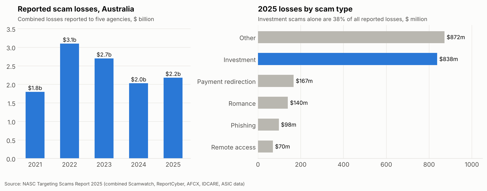
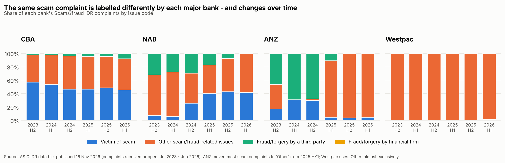
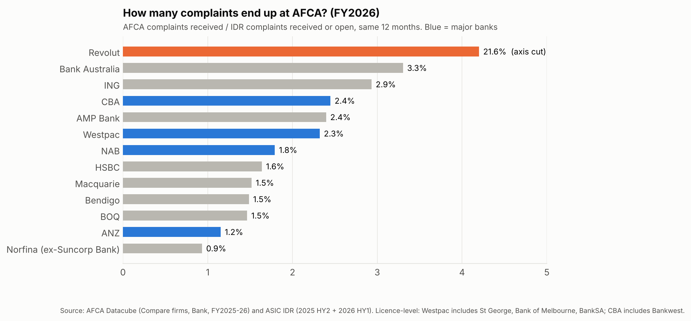
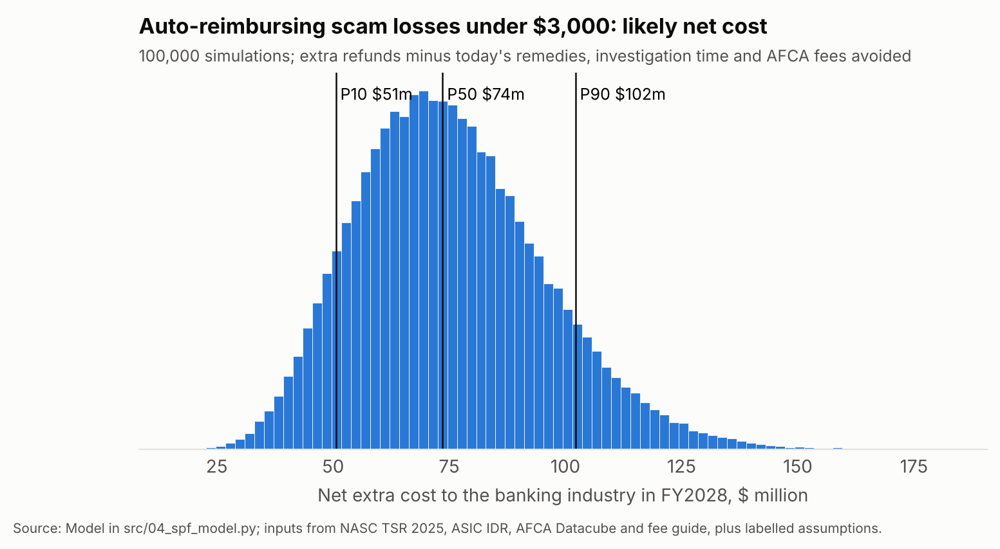
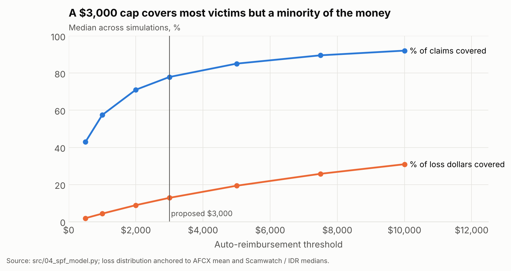
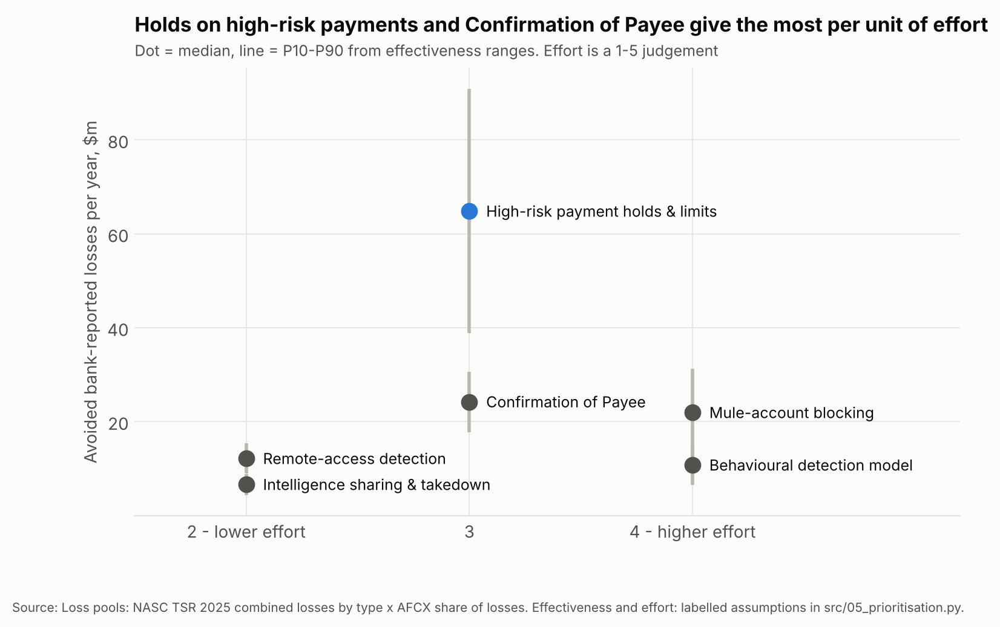

# Scam Reimbursement Readiness: what Australia's Scams Prevention Framework will cost banks, and where to act first

An end-to-end business analytics case study using **only real, public data**: 675,000 rows of ASIC complaint data, AFCA's ombudsman data and the National Anti-Scam Centre's 2025 report. It turns a new regulation into a costed, prioritised plan for a bank.

**Author:** James (Thai Anh) Lai, Master of Business Analytics, Macquarie University

**Tools:** Python (pandas, DuckDB SQL, SciPy, statsmodels, NumPy Monte Carlo), matplotlib / Plotly, Streamlit, Mermaid (process and KPI diagrams)

---

## 1. The business problem
From **31 March 2027**, the Scams Prevention Framework (SPF) makes Australian banks legally responsible for preventing and responding to scams, with penalties up to $50m. Treasury's May 2026 position paper adds a proposal to **automatically reimburse verified scam losses under $3,000**.

A bank preparing for this needs answers to three questions:
1. **What will auto-reimbursement cost?**
2. **Is our scam data good enough to run and report the new process?**
3. **Which controls cut the losses that refunds do not cover?**

## 2. Approach
| Step | What I did | Skills shown |
|---|---|---|
| Frame | Problem statement, scope, stakeholder map, RACI, KPI tree | Business analysis |
| Acquire | Downloaded ASIC's 62 MB IDR file and the NASC report PDF; transcribed AFCA's Power BI Datacube (no export) | Data sourcing, provenance |
| Engineer | Typed DuckDB warehouse, SQL views, 28 automated data-quality checks | Python, SQL, data quality |
| Analyse | Trends, cross-bank benchmarks, a paired Wilcoxon test, a Spearman test | Statistics, EDA |
| Model | 100,000-run Monte Carlo of the $3,000 rule, swing (tornado) analysis, threshold curve | Simulation, decision analysis |
| Prioritise | Value-vs-effort ranking of six SPF controls under uncertainty; pilot sample size | Prescriptive analytics, experiment design |
| Communicate | Executive memo, BRD with user stories, process maps, Streamlit dashboard | Stakeholder communication |

## 3. Key findings
**Scale.** Australians reported **$2.18b** in scam losses in 2025. Banks recorded **199,666** scam reports with a loss, worth **$842.3m** (mean $4,219). Investment scams are 38% of all losses.



**Scam data cannot be compared across banks.** The same scam complaint is coded under different issues at each major bank, and the coding changes over time. ANZ's issue mix moved by up to **82 percentage points** in one half-year, and Westpac codes over **98%** as "Other". The $3,000 rule and SPF reporting both need one taxonomy first.



**Few scam complainants get money back.** There were 178,091 scam and fraud complaints at IDR in FY26, but only **20,141 monetary remedies worth $39.7m** (average $1,973). That is about **4.7%** of bank-reported losses, and money returned per half-year fell **46%** from 2023 H2 to 2026 H1.

**Speed doesn't explain escalation.** Scam and fraud complaints close within 30 days slightly *less* often than each firm's other complaints (median -0.3 pp; Wilcoxon p < 0.001; 231 firm half-years). Of major-bank IDR complaints, **1.9%** reach AFCA. Across 12 banks there is no link between closure speed and escalation (Spearman rho = -0.13, p = 0.70), so differences in how firms record complaints dominate.



**The $3,000 rule: high volume, modest dollars.** In FY2028 an estimated **78% of verified claims (~156,000)** would be refunded automatically. That adds **$74m net** for the industry (P10 $51m, P90 $102m) after today's remedies, investigation time and AFCA fees avoided. Those claims hold only **13% of loss dollars**, so about **$730m** remains in larger scams.




**Where to act first.** Holds and limits on first-time high-risk payments (crypto exchanges, new high-value payees) rank first. Confirmation of Payee ranks second. They are in the top 3 in **100%** and **94%** of simulations.



## 4. Recommendations
1. Adopt one scam taxonomy and data model across fraud ops, IDR and SPF reporting (by Feb 2027).
2. Build a straight-through "verify and refund" path for claims under $3,000; keep full investigation for larger claims (by Mar 2027).
3. Provision at P50, stress-test at P90, and re-run the model each quarter with real claims.
4. Pilot high-risk payment holds with a randomised hold-out (~14,600 flagged payments per arm), then roll out Confirmation of Payee.

Full memo: [`reports/executive_memo.md`](reports/executive_memo.md)

## 5. Business analysis pack
| Document | Contents |
|---|---|
| [01 Problem statement & scope](docs/01_problem_statement_and_scope.md) | Context, business questions, scope, success criteria |
| [02 Stakeholders & RACI](docs/02_stakeholders_and_raci.md) | Stakeholder map, RACI for six workstreams |
| [03 KPI tree](docs/03_kpi_tree.md) | Net scam harm tree, baselines, data gaps |
| [04 Business requirements](docs/04_business_requirements.md) | MoSCoW requirements, data requirements, user stories, acceptance criteria |
| [05 Process map](docs/05_process_map.md) | Current vs future scam-claim process |
| [06 Data sources & lineage](docs/06_data_sources_and_lineage.md) | Sources, lineage, data-quality results, limitations |
| [07 Assumptions register](docs/07_assumptions_register.md) | Every model input, its basis and its swing on the result |

## 6. How to run
```bash
pip install -r requirements.txt
python run_all.py                      # downloads the ASIC file if missing, then rebuilds the database, checks, tables and charts (~2 min)
streamlit run app/streamlit_app.py     # interactive dashboard with live model controls
```

## 7. Repository structure
```
data/raw/            source files (ASIC IDR xlsx, NASC PDF, AFCA transcription)
data/processed/      DuckDB warehouse, provenance.json, findings.json
sql/views.sql        analytical layer
src/00_download.py ... src/05_prioritisation.py   pipeline steps
app/streamlit_app.py Streamlit dashboard
dashboard/index.html standalone HTML dashboard (same model in JavaScript)
reports/             executive memo, figures, tables
docs/                business analysis pack
```

## Licence
Code: MIT. Data remains under its publishers' terms (ASIC, AFCA, NASC/ACCC).

## 8. Limitations
Public, firm-level data only. Complaint counts are "received or open" and self-reported. Monetary remedies exclude refunds made outside complaints. Bank-level estimates depend on how volume is allocated, so two methods are shown. Control effectiveness ranges are assumptions to be replaced by pilot results. This is an independent analysis and is not affiliated with any bank or regulator.

## Sources
- ASIC, Internal dispute resolution data dashboard and data file (published 16 Nov 2026)
- AFCA Datacube, Compare firms (accessed 22 Nov 2026); AFCA Complaint Fee Guide
- National Anti-Scam Centre, *Targeting Scams: Report on scams data and activity 2025*
- ASIC, Scams Prevention Framework; Treasury SPF consultation package and IDR position paper (28 May 2026), as summarised by Ashurst, Clayton Utz and Corrs
