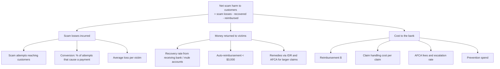

# 3. KPI tree

The goal under the SPF is to **reduce net scam harm to customers at an acceptable cost**. Each branch below lists the KPI, the data that feeds it today, and what is still missing.

| KPI | Definition | Baseline found in this project | Source | Gap |
|---|---|---|---|---|
| Bank-reported scam losses | $ lost by customers who report to their bank | $842.3m in 2025 (industry), mean $4,219 per report | NASC TSR 2025 (AFCX) | Bank's own figure needed |
| Scam & fraud IDR complaints | Complaints received or open, Scams/fraud category | 178,091 in FY26 across all firms; 79% at 13 peer banks | ASIC IDR | Not comparable at issue level (taxonomy) |
| Money returned through IDR | Monetary remedies on scam/fraud complaints | $39.7m in FY26, average $1,973 | ASIC IDR | Excludes refunds outside complaints |
| 30-day closure rate (scam) | % of closed scam complaints closed within 30 days | Slightly below each firm's overall rate (median -0.3 pp) | ASIC IDR | - |
| Escalation rate to AFCA | AFCA complaints received / IDR complaints | 1.9% for the majors (ANZ 1.2% to CBA 2.4%) | AFCA Datacube + ASIC IDR | Scam-specific split by bank not public |
| Share of claims auto-reimbursed | Verified claims under $3,000 / verified claims | 78% modelled (P10-P90: 75-81%) | `04_spf_model.py` | Calibrate with real claims |
| Net cost of auto-reimbursement | Extra refunds - savings | $74m industry FY2028 (P10 $51m, P90 $102m) | `04_spf_model.py` | Calibrate |
| Avoided losses from controls | Loss pool x measured effect | Holds on high-risk payments: $65m (P50, industry) | `05_prioritisation.py` | Replace assumed effect with pilot result |
