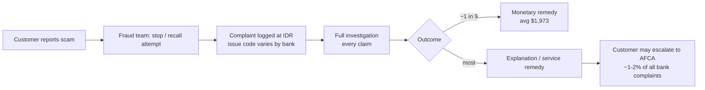
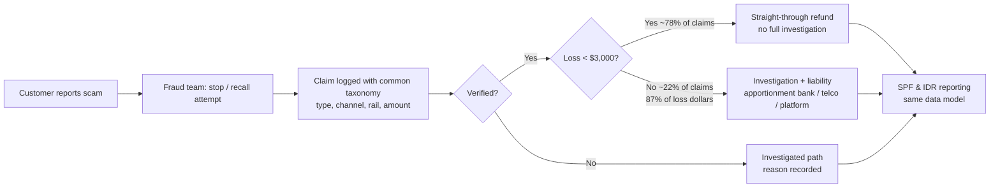

# 5. Process map: scam claim handling, current vs future state

## Current state (simplified)
Every scam complaint goes through the same investigation, whatever the amount. Most end without any money returned: today about 1 in 9 scam and fraud complaints gets a monetary remedy (20,141 remedies on 178,091 scam/fraud complaints across all firms in FY26).

## Future state under the SPF (recommended)

## What changes, and why it matters
| Step | Change | Benefit (modelled, industry, FY2028 P50) |
|---|---|---|
| Classification | One taxonomy at intake (BR-01) | Comparable reporting; the model can be recalibrated with real data |
| Small claims | Straight-through refund | $20.5m of investigation effort avoided; $2.1m of AFCA fees avoided |
| Large claims | Investigation kept, focus on liability | Effort concentrated where 87% of the money is |
| Prevention | Holds and Confirmation of Payee | $65m + $24m of avoided losses (P50, before overlap) |
