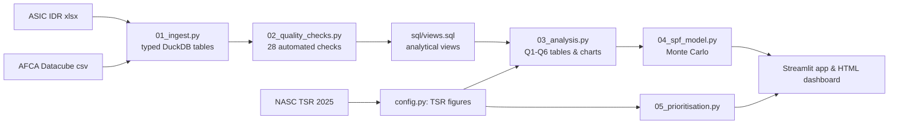

# 6. Data sources, lineage and quality

## Sources (all public)
| Dataset | Publisher | Coverage | Grain | How obtained |
|---|---|---|---|---|
| IDR data file (`idr_data_file_20261116.xlsx`, 62 MB, 7 sheets, 675k rows) | ASIC | Complaints received or open, Jul 2023 - Jun 2026 (6 half-years), ~1,650 firms | Firm x half-year x product / issue / outcome | Direct download from ASIC's IDR dashboard page |
| AFCA Datacube, Compare firms, Primary business = Bank | AFCA | FY2025 and FY2026 | Firm x financial year | Transcribed from the Datacube table (Power BI, no export) into `afca_datacube_banks.csv`, 40 rows |
| Targeting Scams Report 2025 (PDF, 49 pages) | National Anti-Scam Centre (ACCC) | Calendar 2021-2025 | National aggregates by source, scam type, contact method, payment method, age | Direct download; tables read with `pdfplumber` and checked against the rendered pages |
| AFCA Complaint Fee Guide | AFCA | FY2024-25 fees (+3.5% for FY26) | Fee per closure stage | Published PDF |
| SPF obligations and IDR position paper | ASIC, Treasury (via law-firm summaries) | 2025-2027 | Policy | Web |

## Lineage

## Data-quality results (`reports/tables/data_quality.csv`)
25 checks pass, 3 warn, 0 fail. The warnings are features of the data that the analysis handles:
1. **Issues are multi-select.** Issue rows add up to 1.15x the firm total, so scam counts are never added to other issues.
2. **Outcomes are multi-select.** For scam victims, outcome rows are 1.13x complaints, so outcome rates are calculated as outcome count / complaints.
3. **Median above mean** in some small cells (left-skewed). Dollar totals use count x average; medians are only reported.

## Known limitations
- IDR counts are "received **or open**" in each half-year, so a long-running complaint can appear in two halves.
- Data is self-reported by firms and not verified by ASIC. A large count can reflect better recording rather than worse service.
- Issue coding differs between banks (Q3). Bank-level scam volumes are therefore allocated two ways (scam/fraud share and all-complaint share), and both are shown.
- Monetary remedies exclude refunds made outside the complaints process (for example by the fraud team on first contact), so $39.7m understates what banks return to victims.
- NASC warns that AFCX figures are not fully comparable year to year (2025 methodology change). The growth assumption is therefore a wide range.
